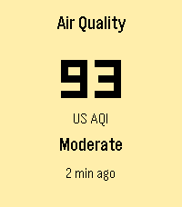

# Pebble Air

A Pebble Time 2 watchapp that shows the current US AQI from an air quality station.

## Choose a station

1. Find the location in the [list of all stations](https://api.airgradient.com/public/api/v1/world/locations/measures/current) and note its `locationId`.
2. Copy `station.example.js` to `src/pkjs/station.js` and put that ID in it. This file is not committed, and the app does not build without it.
3. Build and install.

## Troubleshooting

| On the watch | Meaning | What to check |
|---|---|---|
| `No network` | The request failed or was not allowed | Network access for the app in the Pebble phone app, and the phone's internet connection |
| `No phone` | No reply from the phone | Bluetooth, and that the Pebble phone app is running |
| `Station offline` | The station reports that it is offline | Try again later, or use another station |
| `Bad data` | The response has missing or invalid values | Open the station URL and check `pm02`, `rhum` and `timestamp` |
